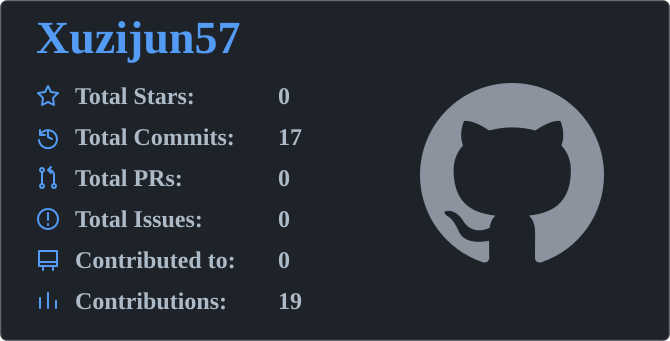

# Xuzijun57

I study physics at Fudan University, with interests in condensed matter physics and AI for physics.

I am currently studying classical mechanics, electrodynamics, quantum mechanics, and thermodynamics and statistical mechanics. My current collaborative project focuses on LLM evaluation for Physics Olympiad problems and data synthesis.

Contributions includes public and anonymous private activity across all years. Public Commits counts publicly searchable commits only. The remaining figures show public activity; contributed repositories cover the past year.

<!-- aggregate:start -->
Visible contributions across all years **757**, including commits and other contribution types. Private activity is included only when GitHub exposes anonymous private contributions.
<!-- aggregate:end -->
